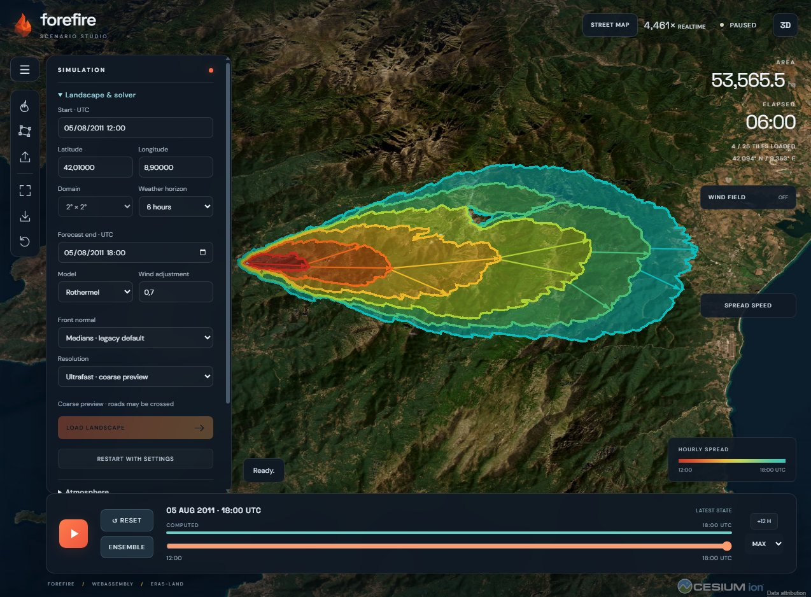

ForeFire
========

**ForeFire** simulates how a wildfire spreads across a landscape: from the fuel, the terrain, the wind and where the fire starts, it computes where the fire front is at each moment. It runs from Python, from the command line or in the browser, and is developed by CNRS at the `Université de Corse Pascal Paoli <https://www.univ-corse.fr/>`_.

   Six hours of a fire in Corsica, one colour per hour, in the Scenario Studio. Click to open it in your browser.

.. code-block:: bash

   pip install forefire

`Try it in the browser <https://forefireapi.github.io/forefire/>`_ · `Server-side demo <https://forefire.univ-corse.fr/sim>`_ · `GitHub <https://github.com/forefireAPI/forefire>`_ · `JOSS paper <https://doi.org/10.21105/joss.08680>`_

New here? Light your first fire in :doc:`getting_started/quickstart`, from the browser, Python or the command line.

.. toctree::
   :maxdepth: 1
   :hidden:
   :caption: Getting Started

   getting_started/introduction
   getting_started/quickstart

.. toctree::
   :maxdepth: 1
   :hidden:
   :caption: Setting Up a Simulation

   user_guide/simulation_inputs
   user_guide/forefire_script
   user_guide/fuels_and_models
   user_guide/models

.. toctree::
   :maxdepth: 1
   :hidden:
   :caption: Landscapes

   user_guide/python_arrays
   user_guide/landscape_file
   user_guide/tiles

.. toctree::
   :maxdepth: 1
   :hidden:
   :caption: Going Further

   user_guide/ensembles
   user_guide/checkpoints
   user_guide/scenario_studio
   user_guide/mesonh
   user_guide/core_concepts

.. toctree::
   :maxdepth: 1
   :hidden:
   :caption: Reference

   reference/commands
   reference/parameters

.. toctree::
   :maxdepth: 1
   :hidden:
   :caption: For Developers

   getting_started/installation
   user_guide/writing_models
   reference/api_reference

.. toctree::
   :maxdepth: 1
   :hidden:
   :caption: About

   about/statement_of_need
   about/citation
   about/license
