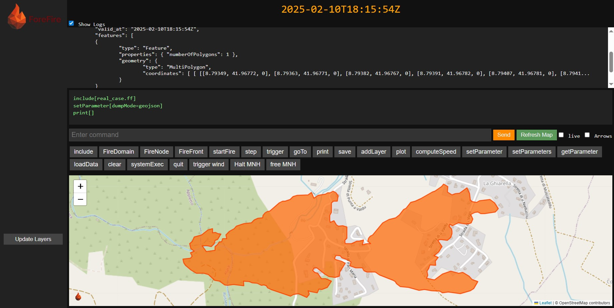

# Web interface for `listenHTTP`

Static pages served by `listenHTTP[]` from `$FOREFIREHOME/tools/htdocs`:

- `index.html`: console to send commands to a running simulation and view the map.
- `mnh3d.html`: 3D view of a coupled Meso-NH run.
- `metflix.html`: player for raw data streams.

Start `forefire` in a case directory, run `listenHTTP[]` and open
<http://localhost:8000/>. Step by step with Docker: the
[quickstart](https://forefire.readthedocs.io/en/latest/getting_started/quickstart.html#quickstart-docker).

